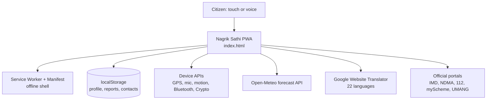
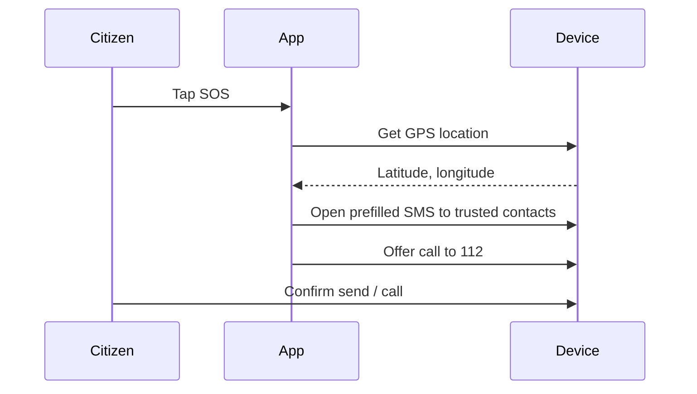
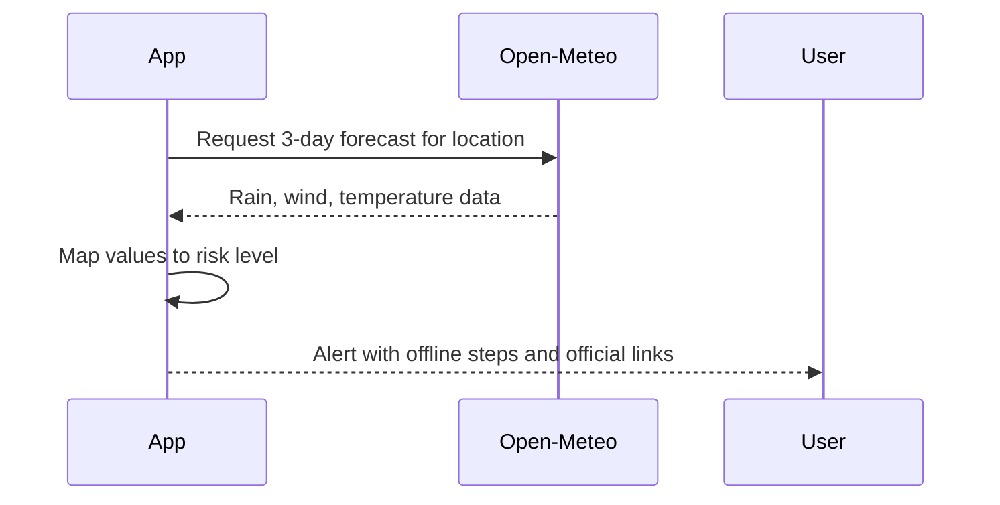

# Nagrik Sathi: Technical Design Document

## 1. Overview
Nagrik Sathi is a single-file, offline-first Progressive Web App (PWA). All logic runs in the browser; there is no application server, database or login service.

## 2. Goals and constraints
- Work on low-end phones and weak networks
- Zero backend cost, easy to host (static hosting, GitHub Pages)
- Privacy: no personal data leaves the device
- Accessible: 22 languages, voice, captions, large text, high contrast

## 3. Architecture

## 4. Modules
| Module | Responsibility |
|---|---|
| Safety and SOS | Trusted contacts, prefilled SMS with location, `tel:112` call, shake trigger |
| Disaster alerts | Fetch 3-day forecast, classify risk (IMD rainfall categories), offline safety steps |
| Report and places | Civic problem report with photo and GPS, saved locally; nearby places |
| Services and schemes | Categorised links to official `.gov.in` portals, helplines |
| Voice assistant | "Hi Bharat" via Speech Recognition and Speech Synthesis |
| Language | Google Website Translator plus Hindi fallback and Bhashini link |
| Profile | Optional local profile; password-derived key using Web Crypto PBKDF2 |

## 5. Data flows
### 5.1 SOS

### 5.2 Disaster alert

## 6. Data storage
All data is in browser `localStorage` on the user's device: profile, trusted contacts, saved reports, preferences. Nothing is uploaded. Photo location (EXIF) data is stripped before saving.

## 7. Security and privacy
- No accounts on a server; no tracking
- Optional password uses PBKDF2 key derivation (Web Crypto)
- Only official domains are linked; scam warnings shown
- Permissions requested only on use

## 8. Offline strategy
The Service Worker caches the app shell. Safety steps, helplines and saved reports work offline. Forecast alerts and external links need a connection.

## 9. Risks and mitigations
| Risk | Mitigation |
|---|---|
| Web app cannot send SMS silently | Prefilled SMS plus direct 112 call; native wrapper planned |
| Alerts are indicative only | Disclaimer; links to IMD, Sachet, NDMA |
| Links and numbers change | Official domains; scheduled link audits |
| Translation gaps | Hindi fallback, Bhashini link |

## 10. Future work
Push alerts via native wrapper, CAP feed, district dashboard, community-reviewed translations.
